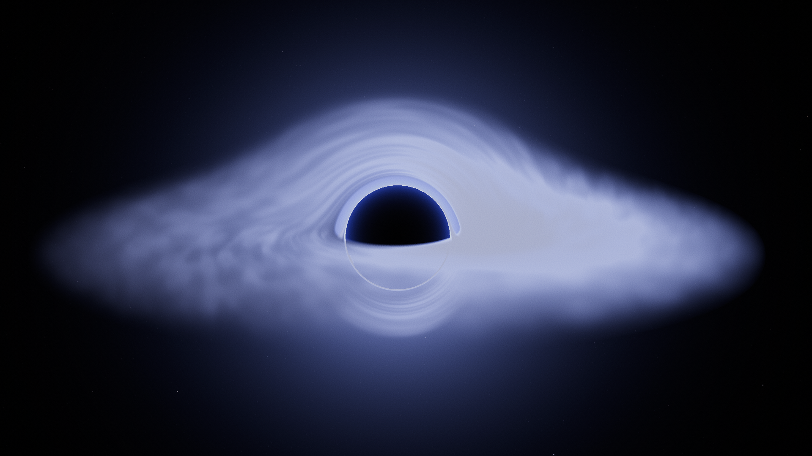
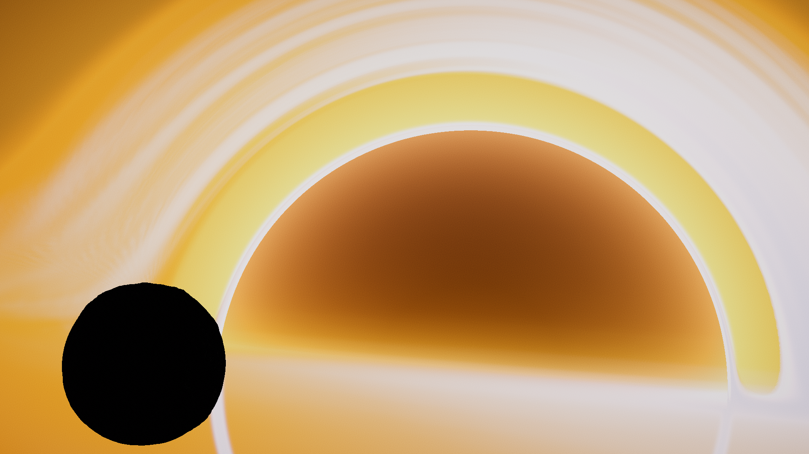
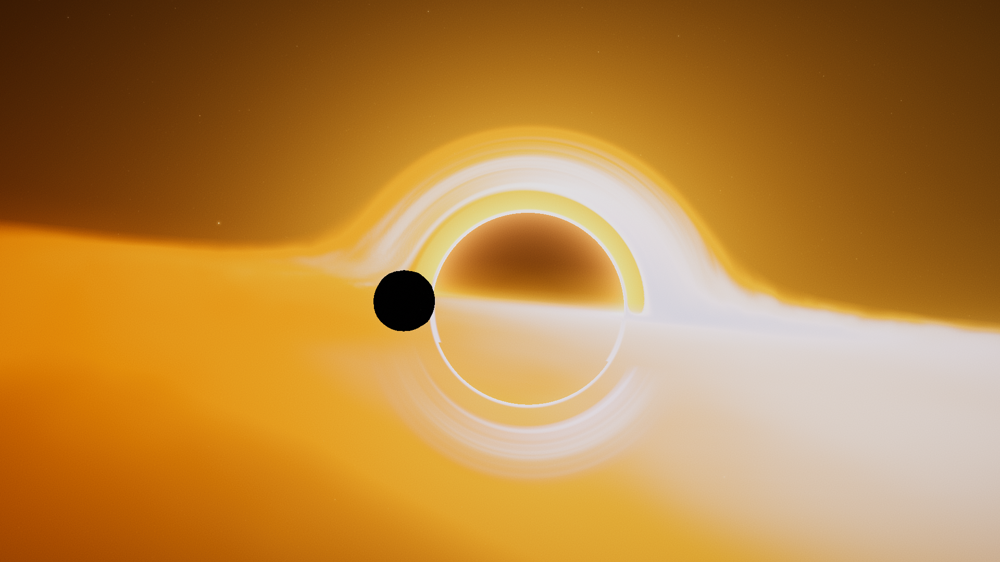
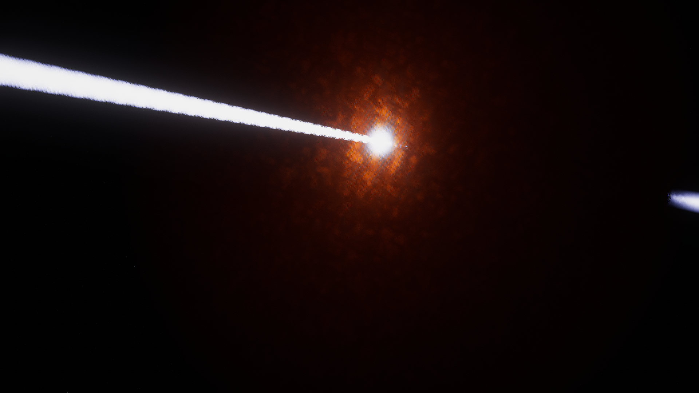

# StellarEffects

A volumetric effects mod for anything in space, planets, stars, black holes, etc. Inspired by KSPVE, except done from scratch without bloat.

---

**Features:**

- Volumetric Blackhole Accretion Disks & Blackhole Jets
- Volumetric Quasar Torus' & Quasar Jets
- In-game config editor / creator (Ctrl + Alt + V to open)
- Volumetric Nebulae
- Evaporating Planet Effect
- Volumetric Comet Tails
- Volumetric Neutron Star Effects
- Volumetric Aurorae

**Planned Features:**

- Universal Volumetric Effect
- Advanced Aurorae

---

Existing Configs (For Other Planet Packs):

[Kcalbeloh](https://spacedock.info/mod/4785/Kcalbeloh-StellarEffects)

---

**Pictures:**

---

**License:**

All Rights Reserved
